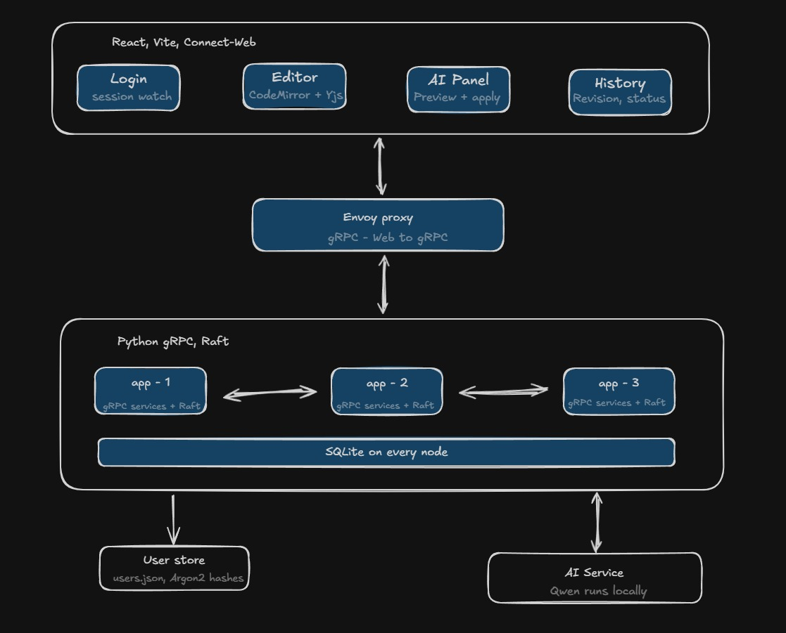
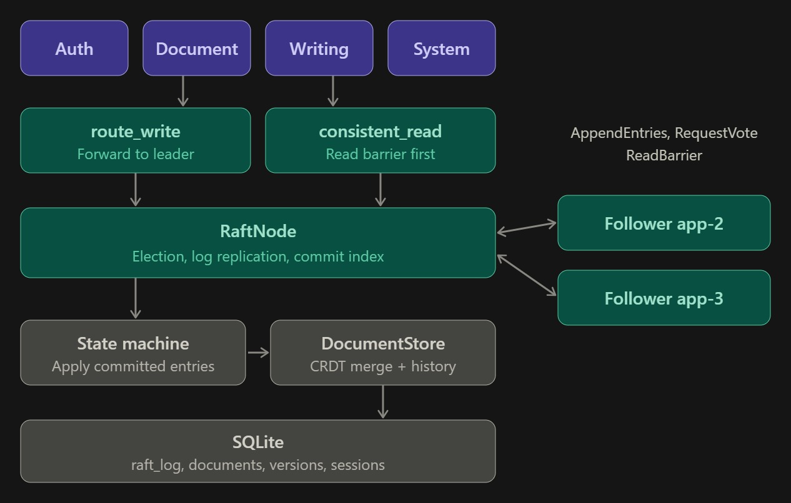
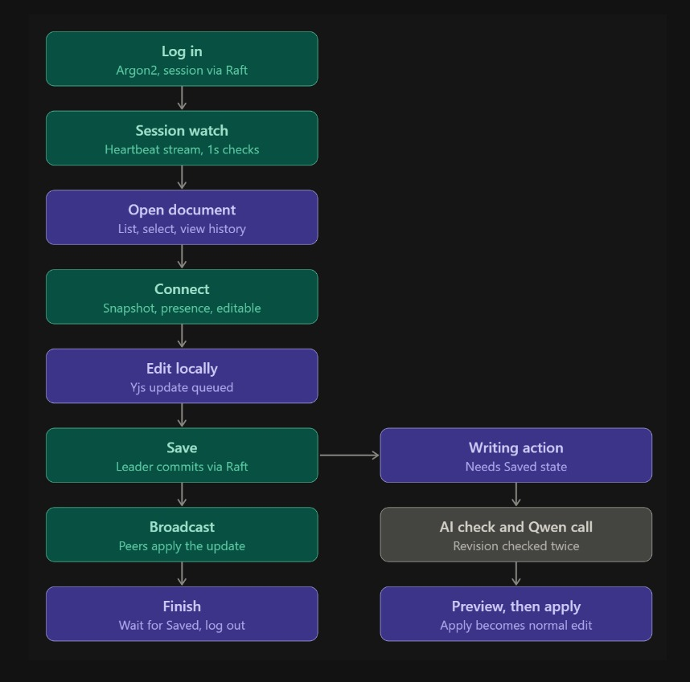

# EchoDoc

Install and start [Docker Desktop](https://www.docker.com/products/docker-desktop/). Run commands from the repository root.

EchoDoc is a collaborative note editor with real-time editing, document version
history, and local AI writing assistance. Three Python backends use Raft to
replicate documents and sessions, while the browser reconnects automatically
when a backend fails. Docker Compose runs the complete setup locally.

## Diagrams

### System architecture



### Backend architecture



### User workflow



## macOS — first run

```bash
docker desktop start
docker compose build
docker compose run --rm --no-deps app-1 python -m backend.seed_users --output /accounts/users.json
docker compose up -d
```

## Windows — first run (PowerShell or WSL Ubuntu)

Open Docker Desktop from the Windows Start menu. For WSL, enable Ubuntu under **Settings → Resources → WSL Integration**.

```sh
docker version
docker compose build
docker compose run --rm --no-deps app-1 python -m backend.seed_users --output /accounts/users.json
docker compose up -d
```

**Open:** http://127.0.0.1:5373

**Login:** `alice` or `bob`, using the passwords chosen during setup.

## Subsequent runs — both systems

```sh
docker compose up -d --build
```

## Stop

```sh
docker compose down
```
